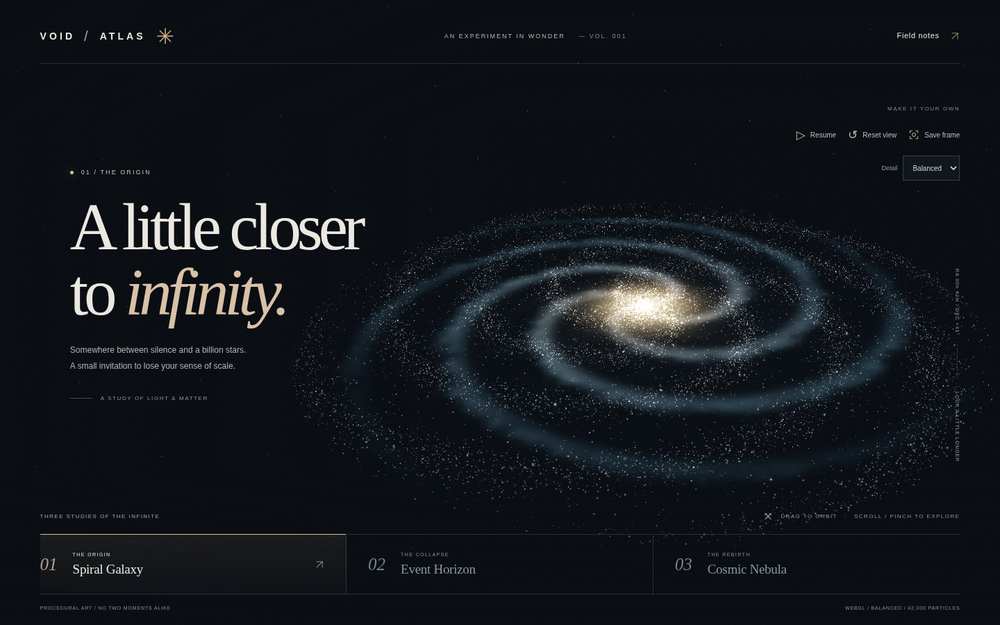

# VOID ATLAS

**Three studies of the infinite.** An interactive, procedural digital artwork built with Three.js, Vite, BufferGeometry and custom GLSL shaders.

Spiral Galaxy, Event Horizon and Cosmic Nebula share a GPU particle system, while each has its own composition, palette and motion. A separate Canvas 2D edition preserves interaction when WebGL 2 is unavailable or interrupted. No paid assets, API keys, image downloads, external fonts or remote runtime services.



## Run

Tested with Node **24.19.0**, npm **11.9.0** and Chromium **154** on Linux. Node 22.12+ is required; `.nvmrc` pins the tested version.

```sh
npm ci
npm run dev
```

Open the address printed by Vite in your browser. The new app uses ES modules and needs an HTTP server. To revisit the original dependency-free prototype, open `public/prototype.html` directly, or visit `/prototype.html` through Vite. That file is preserved byte-for-byte from the original commit.

In the managed cloud workspace, npm's default home cache may be unwritable. Use `npm ci --cache /workspace/.cache/npm` there.

## Production

```sh
npm run build
npm run preview
```

The deployable artifact is **`dist/`**. Preview serves that production build; it is not the development server. Relative asset paths allow hosting at a project subpath, including GitHub Pages. Scene URLs use `#galaxy`, `#horizon` and `#nebula`; no server-side route rewrites are required.

Pinned direct dependencies: Three.js **0.186.1**, Vite **8.3.4**, Playwright Test **1.64.1**. `package-lock.json` records the resolved dependency tree and integrity hashes.

## Explore

| Action | Mouse / touch | Keyboard |
| --- | --- | --- |
| Change scene | Three chapter buttons | `1`, `2`, `3` or left/right arrows |
| Orbit | Drag / one-finger drag | — |
| Zoom | Scroll / two-finger pinch | `+`, `−` |
| Pause / resume | Motion button | Space (outside a control) |
| Reset camera | Reset view | `R` |
| Export | Save frame downloads a PNG without UI | Focus and activate Save frame |
| Help | Field notes | Tab / Enter; Escape closes |

System reduced motion starts paused, with instant scene changes and an accurate Resume label. Motion can be resumed deliberately. Hidden tabs suspend rendering and reset timing on return. Paused, settled scenes do not redraw unnecessarily.

Detail selection offers Auto, High, Balanced and Light. Auto starts from device hints and can lower detail after sustained slow frame cadence; manual choices are respected. Field notes also offers an explicit lightweight Canvas edition, and a retry action restores WebGL when available.

| WebGL detail | Scene particles | Maximum DPR |
| --- | ---: | ---: |
| High | 76,000 | 1.75 |
| Balanced | 42,000 | 1.4 |
| Light | 18,000 | 1 |

There are 1,000 additional background stars. The independent Canvas edition uses 3,800 desktop / 1,800 mobile points and caps DPR at 1.5. Particle motion runs in the vertex shader; geometry is generated once. Scene transitions interpolate positions and shading, without clearing to black or allocating a second full-screen render target.

## Test and measure

```sh
npm test
```

This runs Node unit tests and Playwright against an automatically built and served **production** artifact. The suite covers real framebuffer illumination, different scenes, PNG dimensions, pause/resume, mouse/touch/pinch controls, rapid transitions, quality budgets, resizing, deep links, reduced motion, Canvas compatibility, simulated context loss and recovery, and browser/HTTP errors.

The config uses `/usr/bin/chromium` when available. Otherwise install a Playwright browser with `npx playwright install chromium`. Override the executable with `PLAYWRIGHT_CHROMIUM_EXECUTABLE_PATH` if necessary. Linux CI may need `npx playwright install --with-deps chromium`.

- Browser projects: 1440×900 desktop and 390×844 mobile emulation; additional 320×640 and 844×390 layout checks.
- Reports: `playwright-report/`; failure traces and current-run screenshots/downloads: `test-results/` (ignored in Git).
- A GitHub Actions workflow is included, but local success is not a claim that remote CI ran.
- See [executed verification](docs/VERIFICATION.md) and [measured frame cadence](docs/PERFORMANCE.md). Headless SwiftShader and emulation do **not** establish real-device, Safari/iOS or mobile-GPU performance.

To reproduce the diagnostic measurement, first run `npm run preview -- --port 4174`, then in another terminal run `npm run measure`. This overwrites `docs/performance.json` with fresh measurements. It reports RAF frame cadence, not GPU timer-query execution time.

## Architecture and scope

- [`src/webgl-renderer.js`](src/webgl-renderer.js): Three renderer, orbit camera, geometry, quality budgets and resource disposal.
- [`src/shaders.js`](src/shaders.js): GPU particle motion, spiral dust, accretion disk, photon silhouette and procedural nebula emission.
- [`src/canvas-renderer.js`](src/canvas-renderer.js): independent compatibility renderer.
- [`src/main.js`](src/main.js): shared controls, motion preferences, scene transitions and renderer recovery.
- [`ART_DIRECTION.md`](ART_DIRECTION.md), [`REVIEW.md`](REVIEW.md), [`PORTFOLIO_CASE_STUDY.md`](PORTFOLIO_CASE_STUDY.md): visual rationale, review and portfolio notes.

The nebula is volumetric-inspired (a procedural emission billboard plus a 3D point volume), not a ray-marched volume. The horizon is a designed disk and photon-ring silhouette, not a relativistic simulation. Screenshots retain the drawing buffer for reliable exports; this trades some framebuffer memory for dependable capture. There is no heavy bloom chain, audio, video export or external model loading.

## Hosting

Build and upload the **contents** of `dist/` to a static host. On GitHub Pages, select an authenticated Actions/static-artifact publishing workflow and deploy the built directory, rather than the source root. On hosts with a build UI, use `npm ci && npm run build` and publish directory `dist`. Verify all three hash scenes and a downloaded PNG on the actual deployed URL.

No deployment URL is claimed. This cloud session has no configured deployment-provider credentials, and its GitHub API request was denied. Local Git review and the production artifact are available; deployment and remote PR creation require working authorization through the chosen provider.

## Attribution

AI-assisted art direction and implementation. All visual assets are procedural or original inline SVG. No third-party photographs or models are bundled. [Portfolio notes](PORTFOLIO_CASE_STUDY.md) leave personal identity, contribution and outcome fields as TODO; complete those truthfully before presenting this as a personal case study. Three.js and the development tools retain their respective open-source licenses.
