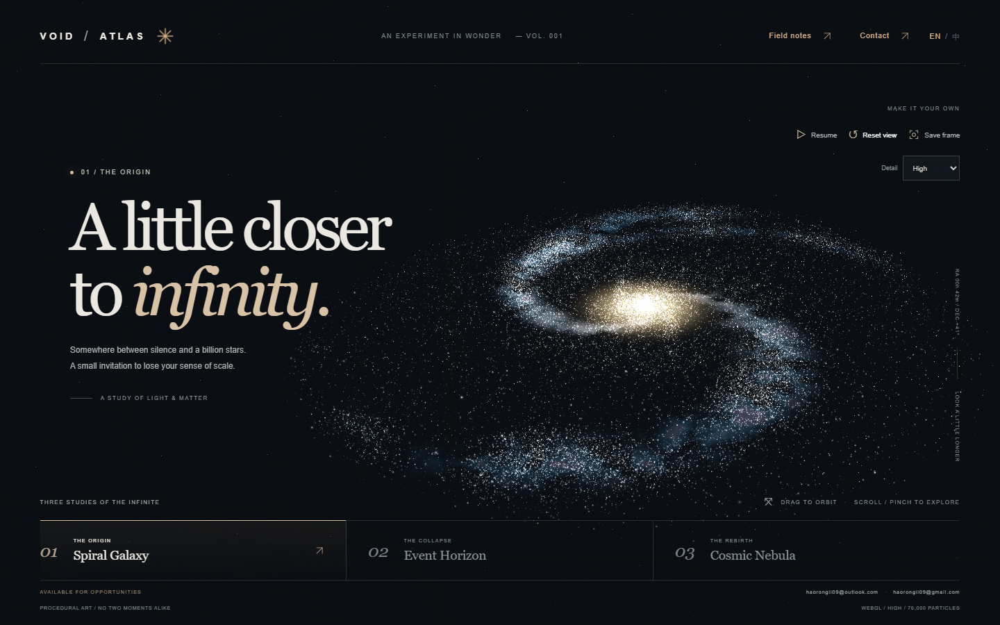

# VOID ATLAS

**Three studies of the infinite.** An interactive, procedural digital artwork built with Three.js, Vite, BufferGeometry and custom GLSL shaders.

Spiral Galaxy, Event Horizon and Cosmic Nebula share a GPU particle system, while each has its own composition, palette and motion. A separate Canvas 2D edition preserves interaction when WebGL 2 is unavailable or interrupted. No paid assets, API keys, image downloads, external fonts or remote runtime services.

## V3 release

The approved visual implementation is frozen at **d38dc97**. Release documentation and screenshots do not change the running artwork. The former stable version is **804163b**; the independent development branch is **codex/visual-quality-v3**. Publishing the new main branch to the WorkBuddy site requires a separate approval.

| Scene | Implementation |
| --- | --- |
| Spiral Galaxy | Asymmetric, spatially correlated disk density with branches, sparse interarm stars and a warm three-dimensional bulge |
| Event Horizon | A depth-writing sphere correctly occludes the far accretion disk across orbit angles; lensing is an artistic approximation |
| Cosmic Nebula | A 128³ procedural density volume, ray marching, separate cloud render target, full-resolution stars and bounded star attenuation |



[Final screenshot index](docs/RELEASE.md#screenshots-and-video) · [V3 visual and performance evidence](docs/V3_ROUND2.md) · [Release and WorkBuddy deployment handoff](docs/RELEASE.md)

## Run

V3 was verified on Windows with Node **24.22.0**, npm **11.19.1**, Git **2.53.0.windows.3**, system Edge **155**, and an NVIDIA RTX 4060 Laptop GPU. Node 22.12+ is required. `.nvmrc` retains the earlier 24.19.0 pin; dependencies and version pins were not upgraded for release.

```sh
npm ci
npm run dev
```

Open the address printed by Vite in your browser. The new app uses ES modules and needs an HTTP server. To revisit the original dependency-free prototype, open `public/prototype.html` directly, or visit `/prototype.html` through Vite. That file is preserved byte-for-byte from the original commit.

For a fresh checkout, `npm ci` installs the locked dependencies. The current Windows checkout already has working dependencies: do not reinstall them for release. WorkBuddy recorded a local bulk-delete guard affecting `npm ci`; see the historical [handoff](docs/HANDOFF.md) before reinstalling in this existing checkout.

## Production

```sh
npm run build
npm run preview
```

The deployable artifact is **`dist/`**. Preview serves that production build; it is not the development server. Relative asset paths allow hosting at a project subpath, including GitHub Pages. Scene URLs use `#galaxy`, `#horizon` and `#nebula`; no server-side route rewrites are required.

Pinned direct dependencies: Three.js **0.186.1**, Vite **8.3.4**, Playwright Test **1.64.1**. `package-lock.json` records the resolved dependency tree and integrity hashes.

## Explore

| Action | Mouse / touch | Keyboard |
| --- | --- | --- |
| Change scene | Three chapter buttons | `1`, `2`, `3` or left/right arrows |
| Orbit | Drag / one-finger drag | — |
| Zoom | Scroll / two-finger pinch | `+`, `−` |
| Pause / resume | Motion button | Space (outside a control) |
| Reset camera | Reset view | `R` |
| Export | Save frame downloads a PNG without UI | Focus and activate Save frame |
| Help | Field notes | Tab / Enter; Escape closes |

System reduced motion starts paused, with instant scene changes and an accurate Resume label. Motion can be resumed deliberately. Hidden tabs suspend rendering and reset timing on return. Paused, settled scenes do not redraw unnecessarily.

Detail selection offers Auto, High, Balanced and Light. Auto starts from device hints and can lower detail after sustained slow frame cadence; manual choices are respected. Field notes also offers an explicit lightweight Canvas edition, and a retry action restores WebGL when available.

| WebGL detail | Scene particles | Maximum DPR |
| --- | ---: | ---: |
| High | 76,000 | 1.75 |
| Balanced | 42,000 | 1.4 |
| Light | 18,000 | 1 |

There are 1,000 additional background stars. The independent Canvas edition uses 3,800 desktop / 1,800 mobile points and caps DPR at 1.5. Particle motion runs in the vertex shader; geometry is generated once. Scene transitions interpolate positions and shading without clearing to black. The nebula owns a reusable lower-resolution cloud render target; settled pause skips rendering.

## Test and measure

```sh
npm test
```

This runs Node unit tests and Playwright against an automatically built and served **production** artifact. The suite covers real framebuffer illumination, different scenes, PNG dimensions, pause/resume, mouse/touch/pinch controls, rapid transitions, quality budgets, resizing, deep links, reduced motion, Canvas compatibility, simulated context loss and recovery, and browser/HTTP errors.

The config uses `/usr/bin/chromium` when available. Otherwise install a Playwright browser with `npx playwright install chromium`. Override the executable with `PLAYWRIGHT_CHROMIUM_EXECUTABLE_PATH` if necessary. Linux CI may need `npx playwright install --with-deps chromium`.

- Browser projects: 1440×900 desktop and 390×844 mobile emulation; additional 320×640 and 844×390 layout checks.
- Reports: `playwright-report/`; failure traces and current-run screenshots/downloads: `test-results/` (ignored in Git).
- The GitHub Actions workflow builds and tests on pushes and pull requests. It does not deploy. Check the latest GitHub run separately; local test success is not a claim of remote CI success.
- The V3 gate passed 12 unit tests and 32 desktop/mobile-emulated E2E tests; release revalidation is described in [release notes](docs/RELEASE.md). See [V3 physical-GPU measurements](docs/V3_ROUND2.md). Earlier [verification](docs/VERIFICATION.md) and [frame cadence](docs/PERFORMANCE.md) are historical. Mobile emulation does **not** establish real-phone performance.

To reproduce the diagnostic measurement, first run `npm run preview -- --port 4174`, then in another terminal run `npm run measure`. This overwrites `docs/performance.json` with fresh measurements. It reports RAF frame cadence, not GPU timer-query execution time.

## Architecture and scope

- [`src/webgl-renderer.js`](src/webgl-renderer.js): Three renderer, orbit camera, geometry, quality budgets and resource disposal.
- [`src/shaders.js`](src/shaders.js): GPU particle motion, spiral dust, accretion disk, spherical event horizon, photon rim, far-side lens image and procedural nebula emission.
- [`src/galaxy-structure.js`](src/galaxy-structure.js): independently seeded, correlated galaxy density sampling.
- [`src/nebula-volume.js`](src/nebula-volume.js): deterministic density generation and CPU cache.
- [`src/canvas-renderer.js`](src/canvas-renderer.js): independent compatibility renderer.
- [`src/main.js`](src/main.js): shared controls, motion preferences, scene transitions and renderer recovery.
- [`ART_DIRECTION.md`](ART_DIRECTION.md), [`REVIEW.md`](REVIEW.md), [`PORTFOLIO_CASE_STUDY.md`](PORTFOLIO_CASE_STUDY.md): visual rationale, review and portfolio notes.

Event Horizon uses a depth-writing sphere at the same world center as the XZ accretion disk and its 3D particle band. Depth testing splits the disk into visible near-side fragments and occluded far-side fragments at every orbit angle; there is no topmost black billboard. A faint, view-dependent image of the far disk supplies the lensing impression. See [the depth repair and captured orbit angles](docs/HORIZON_DEPTH.md).

The WebGL nebula is a ray-marched density volume. High/Balanced/Light use 72/48/32 steps and cloud resolutions of 75%/50%/40% of the main drawing buffer; the stars remain at the main drawing-buffer resolution. The Canvas edition remains a distinct simplified fallback. The horizon's lens image is an artistic approximation, not a relativistic simulation. Screenshots retain the drawing buffer for reliable exports; this trades some framebuffer memory for dependable capture. There is no heavy bloom chain, audio, video export or external model loading.

## Known limits

- Real Android/iPhone hardware, Safari/Firefox and integrated GPUs have not been validated for V3.
- On the measured RTX 4060, the High nebula GPU timer median was 0.447 ms at 1440×900 / DPR 1. This is GPU execution time, not an end-to-end FPS promise.
- Local first WebGL readiness was about 1.20–1.29 s, including synchronous density generation; slower CPUs and public-network load time are unverified. Same-page renderer retries reuse the CPU volume.
- The horizon is not a relativistic simulation. Star attenuation is an eight-sample approximation with a 45% minimum light floor; finite volume resolution can remain visible when zoomed in.
- Build still reports the existing large Three.js bundle warning. No multi-hour or thermal-throttling claim is made.

## Hosting

Build and upload the **contents** of `dist/` to a static host. On GitHub Pages, select an authenticated Actions/static-artifact publishing workflow and deploy the built directory, rather than the source root. On hosts with a build UI, use `npm ci && npm run build` and publish directory `dist`. Verify all three hash scenes and a downloaded PNG on the actual deployed URL.

## Attribution

AI-assisted art direction and implementation. All visual assets are procedural or original inline SVG. No third-party photographs or models are bundled. [Portfolio notes](PORTFOLIO_CASE_STUDY.md) leave personal identity, contribution and outcome fields as TODO; complete those truthfully before presenting this as a personal case study. Three.js and the development tools retain their respective open-source licenses.
